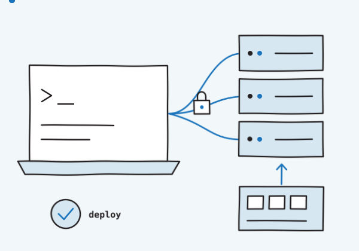
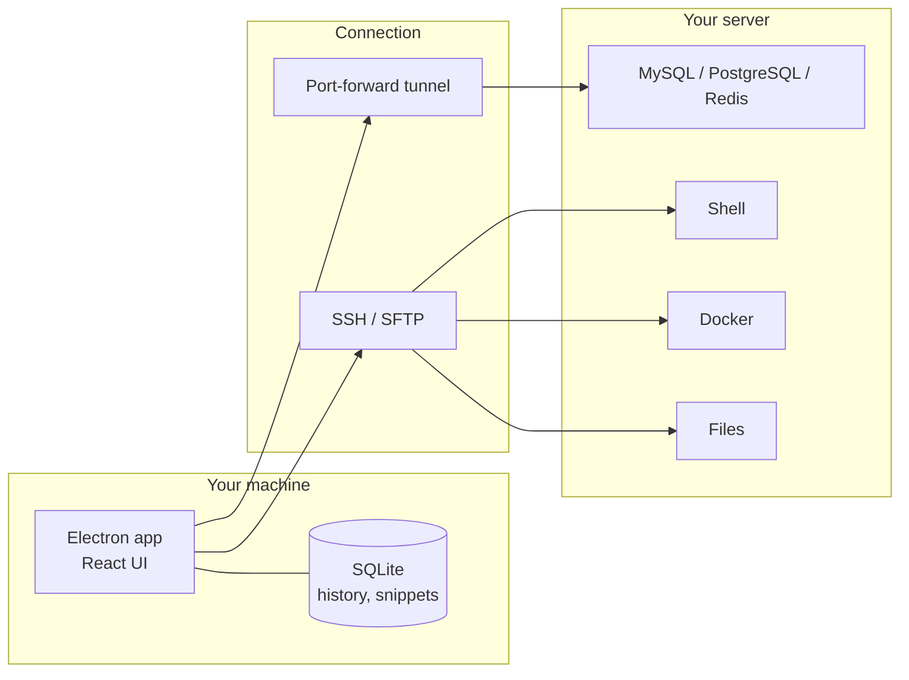

<p align="center">
  
</p>

<h1 align="center">Server Operator</h1>

<p align="center">
  <strong>Manage your servers from one desktop app.</strong><br />
  SSH, remote files, Docker and Compose, databases, deploys and a terminal in a single workspace.<br />
  Open source. Made by <a href="https://beforth.in">BeForth</a>.
</p>

<p align="center">
  <a href="https://github.com/Everest1508/server-operator/releases/latest"></a>
  <a href="LICENSE"></a>
  
  
</p>

<p align="center">
  <a href="https://github.com/Everest1508/server-operator/releases/latest"><strong>Download</strong></a> ·
  <a href="https://server-operator-zeta.vercel.app">Website</a> ·
  <a href="https://server-operator-zeta.vercel.app/changelog.html">Changelog</a> ·
  <a href="https://github.com/Everest1508/server-operator/issues">Issues</a>
</p>

---

## Why Server Operator

Day-to-day server work usually means a terminal, an SFTP client, a Docker dashboard, a database tool and a text editor, all open at once. Server Operator puts them in one window, with the layout and keyboard habits of a code editor, and talks to your servers over plain SSH. There is no agent to install on the server.

## Features

| | |
|---|---|
| **Connections** | SSH with a private key or password, SSH through a Cloudflare tunnel, and an optional global SOCKS5 proxy (such as Tor) that each server can opt out of. Host keys are checked, saved passwords are encrypted, and secrets are redacted from logs. |
| **Local workspace** | Open a folder on your own machine with no SSH. Files, terminal, Docker, logs, databases, deploys and shortcuts all work against it. Launch it from a terminal with `serop .`. |
| **Remote files** | A file tree with the Monaco editor (the VS Code engine), uploads, downloads, search, `Cmd/Ctrl+S` to save and unsaved-change dots on tabs. |
| **Docker and Compose** | List containers, start, stop, restart and read logs from the row, with a filter box and copy. Tail Compose logs by service. Destructive actions ask first. |
| **Databases** | Run MySQL, PostgreSQL and Redis queries through the SSH tunnel, with syntax highlighting, inline row editing, import and export. |
| **Deploys** | Git deploy with presets, history and rollback. Deploys and shortcuts run as **background jobs**, so they keep going when you switch screens, with a jobs list, logs and notifications. |
| **Terminal** | A full xterm.js shell over SSH, sized to its panel. |
| **Wizards** | Generate Nginx reverse-proxy configs, systemd units and firewall (UFW) rules from forms. The firewall warns before it could lock you out of SSH. |
| **AI helpers (optional)** | Deploy chat and config help powered by Groq, with a model picker. Your key stays on your machine and goes only to Groq. Voice input is optional too. |
| **Themes** | Built-in themes, a live theme editor, and custom themes loaded from JSON. |

## Install

Download the build for your system from the [latest release](https://github.com/Everest1508/server-operator/releases/latest):

| System | File |
|---|---|
| macOS (Apple Silicon and Intel) | `.dmg` or `.zip` |
| Windows | NSIS installer (`Setup.exe`) or portable `.exe` |
| Linux (Debian and Ubuntu) | `.deb`, installed with `sudo dpkg -i *.deb` |

<details>
<summary><strong>macOS says the app is "damaged"</strong></summary>

The macOS build is not yet signed or notarized, so Gatekeeper may block it. Copy the app to `/Applications`, then run:

```bash
xattr -cr /Applications/Serop.app
```

This removes the quarantine flag so the app can open.
</details>

## Quick start

1. Open Server Operator and add a server with its host, username and a private key or password. Use **Test connection** before saving.
2. Browse files, open Docker or Logs, or start a terminal for that server.
3. To try it with no server, choose a **Local workspace** and pick any folder.

## Project shortcuts (`.serop`)

Keep your deploy and ops commands in the repository so people and coding agents share one set:

```bash
npx server-operator-init --interactive --path .   # or: npm run serop:init:interactive -- --path .
```

This creates a `.server-operator/` folder with:

*   `deploy.serop`, `ops.serop` and `custom.serop`: command shortcuts, as `[Section]` blocks or `Name = command` lines
*   `AI_CONTEXT.md` and `INSTALLATION_CONTEXT.md`: context for AI assistants

Run a shortcut from the Deploy view and it goes to your terminal or runs as a background job.

## How it works



Everything the UI can do is an IPC call from the renderer to the Electron main process, which holds the SSH connections and runs the commands. Connections are pooled and reused, so repeated file and command operations do not reconnect each time.

## Build from source

You need Node.js and npm.

```bash
git clone https://github.com/Everest1508/server-operator.git
cd server-operator
npm install              # also vendors the Monaco editor assets
npm run electron:dev     # Vite + Electron with live reload
```

| Command | What it does |
|---|---|
| `npm run electron:dev` | Run the app in development with live reload |
| `npm run dev` | Vite only, with no Electron shell (most features need Electron) |
| `npx tsc --noEmit -p tsconfig.json` | Typecheck (there is no separate lint or test script) |
| `npm run electron:build` | Package for your current OS into `release/` |
| `npm run electron:build:mac` / `:linux` / `:win` | Package for a specific OS |
| `npm run website:serve` | Serve the marketing site in `website/` locally |

### Project layout

```
electron/main.js       the backend: SSH/SFTP, Docker, databases, deploys, SQLite
electron/preload.js    the only bridge from the UI to the backend
src/                   the React app (App.tsx, components/, utils/)
themes/                example and bundled theme files
scripts/               CLI helpers (serop, server-operator-init, release tooling)
website/               the public website, plain HTML, CSS and JS
design.md              design notes for the app and the website
```

A new backend feature touches three places together: an `ipcMain.handle` in `main.js`, a method in `preload.js`, and a type in `src/global.d.ts`. See [`CLAUDE.md`](CLAUDE.md) for more detail.

## Custom themes

In Settings, **Create theme** opens a live editor, **Import JSON** loads a file and **Template** downloads an example. Serop also reads theme files from `themes/`, from the folder named in `SEROP_THEMES_DIR`, and from a `themes` folder in the app data folder. A theme needs a `name` and a `colors` object; see [`themes/README.md`](themes/README.md) and [`themes/examples/ocean.json`](themes/examples/ocean.json).

## Contributing

Issues and pull requests are welcome. Please run `npx tsc --noEmit -p tsconfig.json` before sending a change, and describe what you checked in the app, since there is no automated test suite yet.

## License

Copyright © 2026 **BeForth**. Licensed under the [Apache License 2.0](LICENSE).
